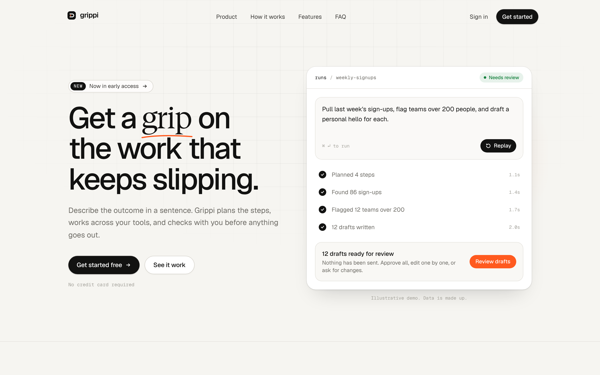

# Grippi — landing page redesign concept

An unofficial redesign concept for [grippi.io](https://grippi.io). Not affiliated with or endorsed by Grippi.



## Stack

- **Next.js 16** (App Router, fully static) + **React 19** + **TypeScript**
- **Tailwind CSS v4**: design tokens live in `app/globals.css` under `@theme`
- **Motion** for entrance, scroll-reveal, accordion and state transitions (respects `prefers-reduced-motion`)
- **Geist** Sans / Serif / Mono, self-hosted via the `geist` package
- [Libraries.dev](https://libraries.dev) effects, used only where they mean something:
  - `border-beam`: runs around the hero composer **only while the agent demo is working**
  - `thinking-orbs`: the live state of each agent step (planning → searching → solving → composing)

## Run it

```bash
npm install
npm run dev     # http://localhost:3000
npm run build   # static production build
```

Deploy: import the repo on Vercel; no configuration needed.

## Before showing this to anyone

This was built **without access to the live grippi.io site**, so the product copy is a draft.

1. Open `content/site.ts`. **All** copy lives there.
2. Replace every line marked `TODO verify` with Grippi's real copy, links and integrations.
3. Set your name and LinkedIn in `concept.author` / `concept.authorUrl` (shown in the footer).
4. Don't add stats, customer logos or testimonials unless they come from Grippi.

## Structure

```
app/            layout, page, global styles + tokens
components/     nav, hero, agent-demo, how-it-works, features, faq, cta, footer
content/site.ts every word on the page
```
