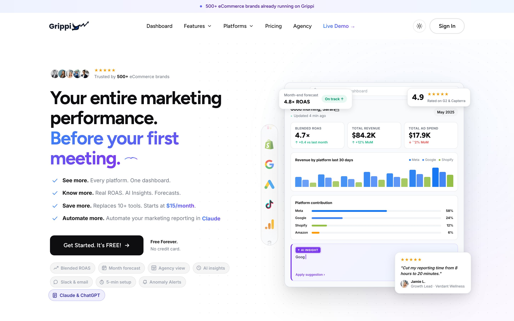
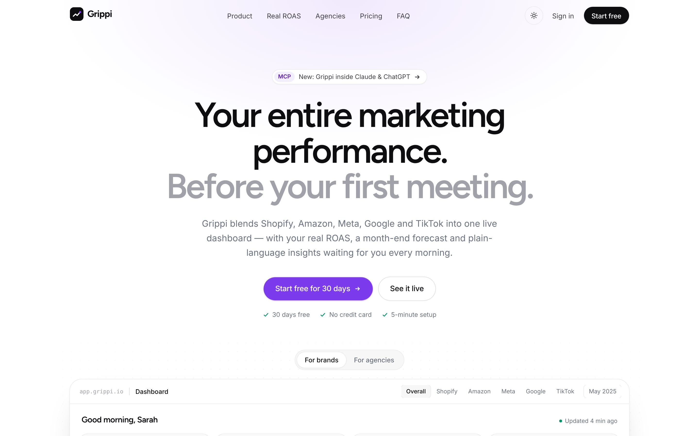
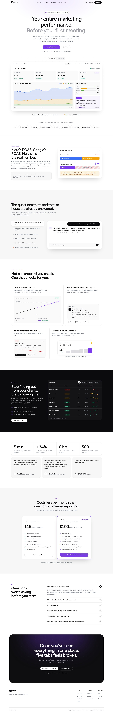

# Grippi landing page: redesign notes

A concept redesign of [grippi.io](https://grippi.io), built in Next.js. Same product, same copy and numbers, half the length, one clear offer.

| Before | After |
|---|---|
|  |  |

## What I changed, and why

**1. Half the scroll, same substance.**
The current page is about 16,900px tall. Comparable YC-backed analytics and growth tools land around 7,000 to 9,000px (Converge 7,400, Basedash 9,200). The redesign is about 9,200px. Nothing important was cut; repeated sections were merged.

**2. One offer, said the same way everywhere.**
The current page says "Free Forever", "30 days free" and "Starts at $15/month" in different places, and repeats "Get Started. It's FREE!" with "No credit card" under it about eight times. The redesign uses one call to action, *Start free for 30 days*, with the same three reassurances under it.

**3. The product is the hero.**
The first screen is now an interactive dashboard with a Brands / Agencies toggle. Numbers count up, the revenue chart draws in and can be hovered, and an AI insight writes itself. A visitor sees what Grippi does before reading a line of copy.

**4. "The real number" gets its own moment.**
Blended ROAS is Grippi's sharpest idea. It's now an animated explainer: Meta claims 6.8× and Google claims 5.4×, a total of 12.2×, but you actually made 4.7×. The 7.5× gap is shown as "counted twice".

**5. "Ask Grippi" is interactive.**
The five questions from the current page are clickable. Each one shows Grippi thinking, then streams its answer, with the Claude / ChatGPT (MCP) angle alongside.

**6. Agencies get a working Masterview.**
A sortable, filterable client table with Healthy / Review / Attention statuses, in a dark band that marks the switch from brands to agencies.

**7. Calmer visual system.**
Grippi's own violet and near-black, with Figtree and Inter, used with restraint. The pastel section panels, gradient text and clouds of feature tags are gone. Colour now only marks data (each ad platform) and the one primary action. Full light and dark modes are kept.

## Bugs found on the live site

These text-encoding glitches are in the current HTML (checked in the page source on 5 Nov 2026):

| Where | Shows | Should be |
|---|---|---|
| Hero dashboard, ad spend card | `↓ ˆ’2% MoM` | `↓ −2% MoM` |
| Hero dashboard greeting | `Good morning, Sarah` + a broken control character (`U+008F`) | `Good morning, Sarah 👋` |
| Forecast section | `†` + a broken character before "Today (Day 15)" | `↓ Today (Day 15)` (or similar) |
| Pricing, Agency plan | `Performance audit †’ Google Slides` | `Performance audit → Google Slides` |

These all look like UTF-8 text being decoded as Windows-1252 somewhere in the build or CMS step. That is usually a one-line fix.

## Also worth a look

- The logo wall and several testimonials use the same brand names as the demo data in the product mockup (Verdant, Northfield, NightShift, Bloom & Root…). A sceptical visitor may read the social proof as placeholder content. Real customer logos, or quotes with photos and links, would be much stronger.
- The stats (5 min, +34%, 8 hrs, 500+) carry a lot of weight. A one-line source for the +34% would make it more credible.

## How it's built

- Next.js 16 (App Router, fully static), React 19, TypeScript, Tailwind CSS v4, Motion
- Libraries.dev effects, used only where they mean something: Thinking orbs for AI loading states, and Border beam while "Ask Grippi" is working and on the Agency plan's button
- Adapted from Aceternity UI: the infinite moving strip of platforms
- All copy in one file (`content/site.ts`), so marketing can edit without touching components
- Accessible: semantic tables, labelled controls, keyboard support, `prefers-reduced-motion` respected, light and dark themes

| Full page: before | Full page: after |
|---|---|
|  |  |
