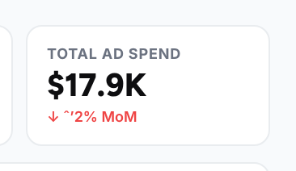
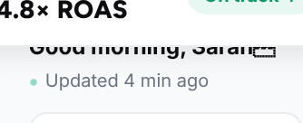
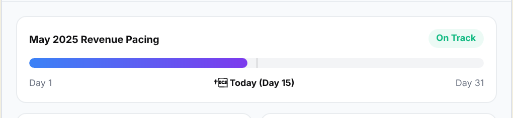
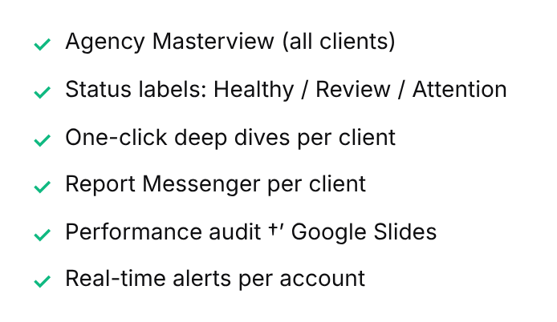

# Grippi landing page: redesign notes

A concept redesign of [grippi.io](https://grippi.io), built in Next.js. Same product, same copy and numbers, half the length, one clear offer.

| Before | After |
|---|---|
|  |  |

## What I changed, and why

**1. Half the scroll, same substance.**
The current page is about 16,900px tall. Comparable YC-backed analytics and growth tools land around 7,000 to 9,000px (Converge 7,400, Basedash 9,200). The redesign is about 9,200px. Nothing important was cut; repeated sections were merged.

**2. One offer, said the same way everywhere.**
The current page says "Free Forever", "30 days free" and "Starts at $15/month" in different places, and repeats "Get Started. It's FREE!" with "No credit card" under it about eight times. The redesign uses one call to action, *Start free for 30 days*, with the same three reassurances under it.

**3. The product is the hero.**
The first screen is a working dashboard, not a picture of one. A side rail switches between three live pages: **Overview**, **Channels** and **Alerts**. Today / Week / Month re-rolls every metric with slot-machine digits. Each platform can be toggled off in the revenue chart, and hovering a bar shows its breakdown. The AI insight writes itself and can be applied or undone. Alerts can be resolved and fold away. A visitor understands Grippi before reading a line of copy.

**4. "The real number" gets its own moment.**
Blended ROAS is Grippi's sharpest idea. It's now an animated explainer: Meta claims 6.8× and Google claims 5.4×, a total of 12.2×, but you actually made 4.7×. The 7.5× gap is shown as "counted twice".

**5. "Ask Grippi" is interactive.**
The five questions from the current page are clickable. Each one shows Grippi thinking, then streams its answer, with the Claude / ChatGPT (MCP) angle alongside.

**6. A bento where every tile is alive.**
The forecast tile has a day slider: drag it and the projection and totals update. The Slack / WhatsApp / email feed posts new messages on its own. The anomaly tile shows a client's ROAS falling through a threshold until the alert fires, and you can pause the campaign. Client report slides sit in a 3D stack you can click or fling.

**7. Agencies get a working Masterview.**
A sortable, filterable client table with Healthy / Review / Attention statuses, in a dark band that marks the switch from brands to agencies.

**8. A closing section that tells the story.**
The last section shows one agency in New York connected to client stores on four continents. Each arc draws in and carries data back, and each store shows its blended ROAS and Healthy / Review / Attention status. It's the Masterview idea, told on a map.

**9. Calmer visual system.**
Grippi's own violet and near-black, with Figtree and Inter, used with restraint. The pastel section panels, gradient text and clouds of feature tags are gone. Colour now only marks data (each ad platform) and the one primary action. Full light and dark modes are kept.

## Bugs found on the live site

Four text-encoding glitches are live on grippi.io (re-checked in the rendered page on 5 Nov 2026):

| Where | What shows | Should be | Screenshot |
|---|---|---|---|
| Hero dashboard, "Total ad spend" card | `↓ ˆ’2% MoM` | `↓ −2% MoM` |  |
| Hero dashboard greeting | `Good morning, Sarah` followed by a box (control character `U+008F`) | the intended emoji |  |
| Forecast card, under the pacing bar | `†` + a box before "Today (Day 15)" | `← Today (Day 15)` |  |
| Pricing, Agency plan | `Performance audit †’ Google Slides` | `Performance audit → Google Slides` |  |

**Cause:** UTF-8 text is being decoded as Windows-1252 somewhere in the build or content pipeline, and the first byte is then dropped. For example:

- `−` is the UTF-8 bytes `E2 88 92`, which read as Windows-1252 give `−`; the page shows `ˆ’`.
- `→` (`E2 86 92`) becomes `→`, shown as `†’`.
- `←` (`E2 86 90`) becomes `†` plus an unprintable `0x90`.

**Fix:** make sure the source files are saved and read as UTF-8, and that the page is served with `<meta charset="utf-8">` / `Content-Type: text/html; charset=utf-8`. Or use HTML entities (`&minus;`, `&rarr;`, `&larr;`) for these symbols.

## Also worth a look

- The logo wall and several testimonials use the same brand names as the demo data in the product mockup (Verdant, Northfield, NightShift, Bloom & Root…). A sceptical visitor may read the social proof as placeholder content. Real customer logos, or quotes with photos and links, would be much stronger.
- The stats (5 min, +34%, 8 hrs, 500+) carry a lot of weight. A one-line source for the +34% would make it more credible.

## How it's built

- Next.js 16 (App Router, fully static), React 19, TypeScript, Tailwind CSS v4, Motion
- [ObsidianUI](https://www.obsidianui.dev) (MIT): slot-machine number animation, segmented control and sparklines, adapted from its Analytics Dashboard; the hero dashboard follows its layout
- [Libraries.dev](https://libraries.dev): Thinking orbs for AI loading states; Border beam while "Ask Grippi" is working and on the Agency plan's button
- [Aceternity UI](https://ui.aceternity.com): Infinite Moving Cards (platform strip) and World Map (closing section). The map is adapted so its ~340 KB of country data is processed at build time instead of being sent to the browser.
- Card stack interaction inspired by Bencho's "Card swap"; original implementation
- All copy in one file (`content/site.ts`), so marketing can edit without touching components
- Accessible: semantic tables, labelled controls, keyboard support, `prefers-reduced-motion` respected, light and dark themes

| Full page: before | Full page: after |
|---|---|
|  |  |
